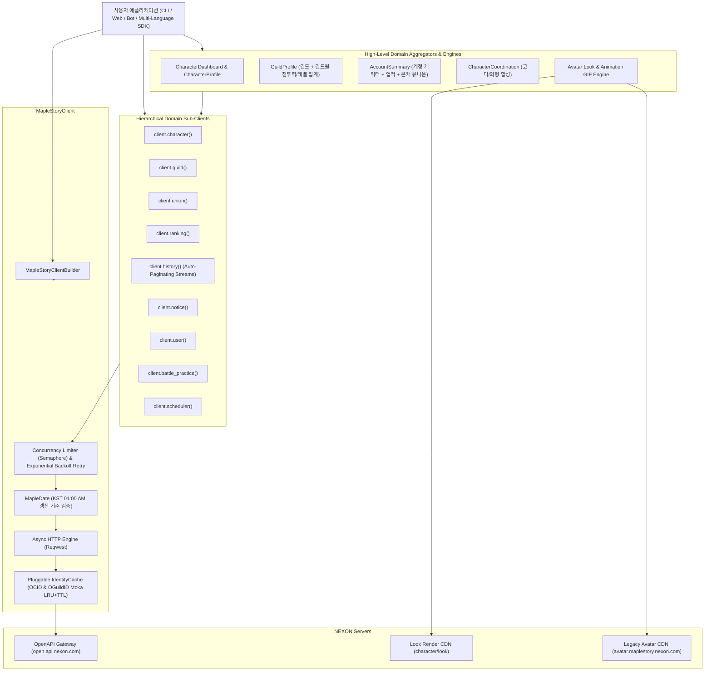

# 시스템 아키텍처 및 설계 원칙 (Architecture)

## 1. 아키텍처 개요

`maplestory-openapi`는 NEXON MapleStory OpenAPI의 공식 엔드포인트를 안전하고 인체공학적으로 다루기 위한 Rust 라이브러리입니다.
단순한 1:1 REST 호출 바인딩에 그치지 않고, 복잡한 게임 도메인 규칙(장비 노출 우선순위, 잠재능력/추가잠재 옵션 파싱, 아바타 바이너리 디코딩, 스탯 및 포스 계산, 길드/유니온/계정 집계)을 **깊은 모듈(Deep Modules)**로 캡슐화하여 제공합니다.

---

## 2. 핵심 설계 원칙

### 1) 계층형 도메인 서브클라이언트 (Hierarchical Domain Namespaces)
- 40개 이상의 플랫 메서드로 인한 네임스페이스 오염을 방지하기 위해 도메인별 서브클라이언트를 제공합니다:
  - `client.character()` (`CharacterClient`)
  - `client.guild()` (`GuildClient`)
  - `client.union()` (`UnionClient`)
  - `client.ranking()` (`RankingClient`)
  - `client.history()` (`HistoryClient`)
  - `client.notice()` (`NoticeClient`)
  - `client.user()` (`UserClient`)
  - `client.battle_practice()` (`BattlePracticeClient`)
  - `client.scheduler()` (`SchedulerClient`)
- 기존 루트 편의 메서드(`client.get_character_dashboard_by_name(...)` 등)도 하위 호환성을 위해 그대로 유지되며 내부적으로 각 서브클라이언트에 위임합니다.

### 2) 내장 동시성 제어 및 지수 백오프 재시도 (Concurrency Limiter & Retry)
- `CharacterDashboard`나 `GuildProfile`처럼 수십 개의 엔드포인트를 병렬 호출할 때 넥슨 API 초당 호출 한도(HTTP 429)에 걸리지 않도록 `tokio::sync::Semaphore` 기반 동시성 제한기(`max_concurrency`, 기본값 10)를 내장했습니다.
- 일시적 네트워크 타임아웃이나 HTTP `429 Too Many Requests` / `500` / `503` 응답 발생 시 `Retry-After` 헤더와 지터(Jitter)가 포함된 지수 백오프(`max_retries`, 기본값 3)를 자동으로 수행합니다.

### 3) 플러그형 식별자 캐시 (`IdentityCache`)
- `닉네임 -> OCID`뿐 아니라 `(길드명, 월드명) -> OGuildID` 매핑까지 캐싱하는 `IdentityCache` 트레이트를 제공합니다.
- 기본 `cache` 피처 활성화 시 `moka` 기반 인메모리 LRU+TTL 캐시가 동작하며, 분산 서버 환경을 위해 Redis 등 커스텀 백엔드를 `MapleStoryClientBuilder::identity_cache(...)`로 주입할 수 있습니다.

### 4) 한국 표준시(KST) 데이터 갱신 주기 검증 (`MapleDate`)
- 넥슨 OpenAPI는 최소 기준일(`2023-12-21`) 이전 날짜 조회가 불가능하며, 전일 데이터는 매일 오전 01:00~02:00 KST 이후에 집계됩니다.
- `MapleDate` 타입과 `DateParam`은 `"YYYY-MM-DD"`, `NaiveDate`, 또는 `MapleDate::latest_available()`을 모두 수용하며, 네트워크 요청 전에 유효하지 않은 날짜를 즉시 검증합니다.

### 5) 깊은 도메인 모델 (Deep Domain Models)
- **장비 잠재능력 파서**: `ItemEquipmentDetail::all_potentials_parsed()`, `ItemEquipmentDetail::total_potential_stat(StatType)`로 보스 데미지, 방어율 무시, 크리티컬 데미지, 주스탯 %, 쿨타임 감소 등을 `StatType` 열거형으로 정밀 집계합니다.
- **유니온 & 성장 헬퍼**: `UserUnionArtifact`, `UserUnionRaider`, `UserUnionChampion`의 스탯 합산 헬퍼와 `CharacterHexaMatrix`, `CharacterVMatrix`, `CharacterAbility`, `CharacterHyperStat`의 코어/프리셋 조회 헬퍼를 제공합니다.
- **자동 페이지네이션 히스토리 스트림**: `client.history().stream_starforce(...)`, `stream_cube(...)`, `stream_potential(...)`은 `next_cursor`를 자동 추적하여 `futures_core::Stream`으로 모든 이력을 스트리밍합니다.

