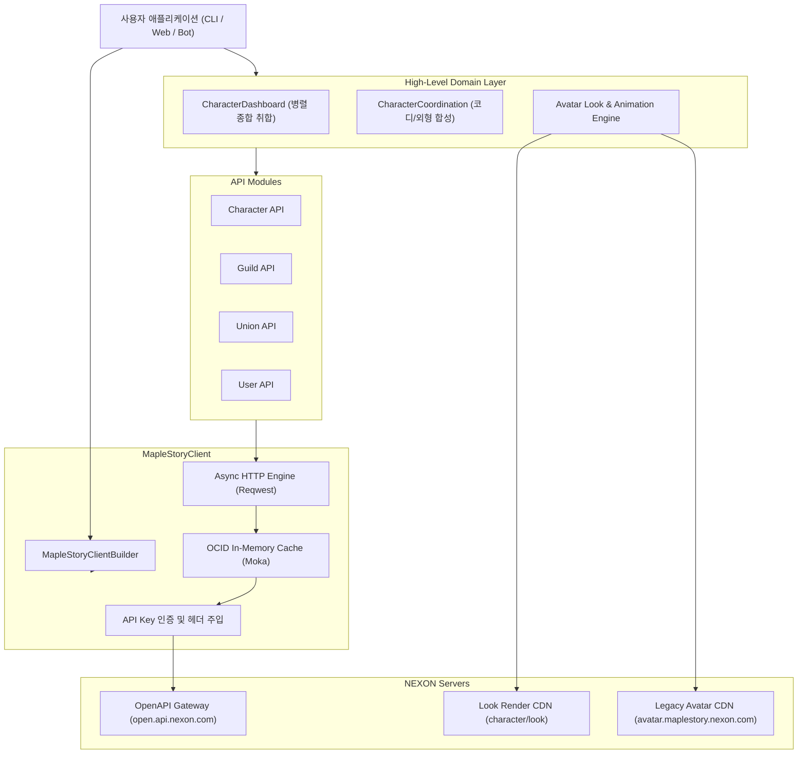

# 시스템 아키텍처 및 설계 원칙 (Architecture)

## 1. 아키텍처 개요

`maplestory-openapi`는 NEXON MapleStory OpenAPI의 공식 엔드포인트를 안전하고 인체공학적으로 다루기 위한 Rust 라이브러리입니다.
단순한 1:1 REST 호출 바인딩에 그치지 않고, 복잡한 게임 도메인 규칙(장비 노출 우선순위, 아바타 바이너리 디코딩, 스탯 및 포스 계산, 길드/유니온 연계)을 캡슐화하여 제공합니다.

---

## 2. 핵심 설계 원칙

### 1) 런타임-애그노스틱 (Runtime-Agnostic) 비동기 설계
- 대다수 Rust 라이브러리가 무거운 `tokio` 런타임 전체를 필수로 의존하여 웹어셈블리(Wasm)나 다른 비동기 런타임(`async-std`, `smol`, `actix`)과의 호환성을 해칩니다.
- 본 라이브러리는 `reqwest`의 내부 비동기 클라이언트와 `futures-util`의 가벼운 인터페이스만을 사용하여, 클라이언트 코드 자체는 특정 런타임에 종속되지 않습니다.
- 사용자는 `#[tokio::main]`, `actix_web`, 또는 임베디드 런타임 등 원하는 환경에서 자유롭게 임포트하여 사용할 수 있습니다.

### 2) 닉네임 중심의 1-Call DX (Developer Experience)
- 공식 넥슨 OpenAPI는 대부분의 조회가 식별자인 `ocid`를 요구하므로, `GET /id` 호출 -> `ocid` 획득 -> 본 API 호출이라는 번거로운 2-Step을 강제합니다.
- 본 크레이트는 모든 주요 엔드포인트에 대해 `*_by_name(character_name)` 헬퍼를 기본 탑재하여, 단 1줄의 함수 호출로 직관적인 비즈니스 로직을 구현할 수 있도록 했습니다.

### 3) 인메모리 OCID 캐싱 (`cache` feature)
- 캐릭터의 `닉네임 -> OCID` 매핑은 닉네임을 변경하지 않는 한 영구적으로 불변입니다.
- `cache` 기능 플래그 활성화 시 `moka` 기반의 비동기 LRU+TTL 캐시가 동작하여:
  - 중복 `GET /id` 호출을 메모리 내에서 즉시 해결 (0ms)
  - 불필요한 네트워크 트래픽 50% 절감
  - 넥슨 API의 초당 호출 제한(Rate Limit)을 효과적으로 방어

### 4) 엄격한 타입 안전성과 유연한 폴백 (Resilience)
- 넥슨 OpenAPI의 JSON 응답은 날짜나 장비 장착 상태, 6차 전직 여부에 따라 특정 필드가 `null`이거나 생략될 수 있습니다.
- 모든 선택적 필드를 `Option<T>`로 안전하게 래핑하고, 알 수 없는 신규 필드가 추가되더라도 역직렬화 에러가 발생하지 않도록 설계되었습니다.
- 정수형 필드(`character_level`, `popularity`, `starforce` 등)는 문자열이 아닌 적절한 숫자 타입(`i64`)으로 자동 변환됩니다.
