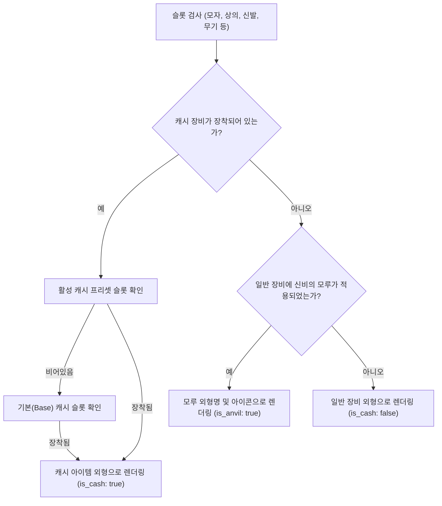
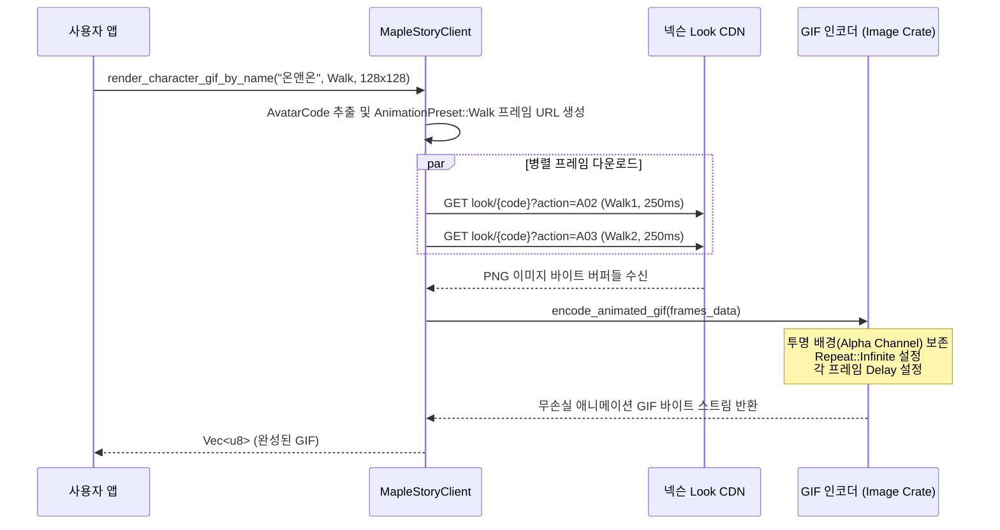

# 코디 합성 및 아바타 모션/애니메이션 엔진 (Coordination & Avatar)

## 1. 코디/외형(Coordination Look) 자동 합성 시스템

메이플스토리 공식 OpenAPI는 뷰티(`beauty-equipment`), 캐시 장비(`cashitem-equipment`), 일반 장비(`item-equipment`)를 각각 완전히 별개의 엔드포인트로 반환합니다.
실제 사용자가 게임 화면에서 보게 되는 최종 외형을 재현하기 위해서는 복잡한 인게임 렌더링 규칙을 적용해야 합니다.

`CharacterCoordination::from_parts()` 및 `from_full_parts()`는 아래 규칙을 완전 자동으로 수행합니다:



### 1) 인게임 레이어 및 예외 규칙 처리
- **한벌옷(Overall) 가림 규칙**: 상의 슬롯에 한벌옷이 장착된 경우, 하의 장비의 렌더링을 자동으로 생략합니다.
- **신비의 모루(Anvil) 감지**: `item_shape_name`과 `item_shape_icon`이 존재할 경우, 원본 능력치 아이템 대신 모루 외형을 최종 노출 아이템으로 채택하며 `original_name` 필드에 실제 장비명을 보존합니다.
- **투명 장비 감지**: 투명모자, 투명장갑, 투명망토, 투명신발, 투명안경 등 투명 캐시 장비를 감지하여 `is_transparent: true` 플래그를 제공합니다.
- **비노출 보조무기 감지**: 마법사의 마도서/오브, 블래스터의 건틀렛 리볼버 보조장비 등 캐릭터 외형에 물리적으로 렌더링되지 않는 보조무기를 식별하는 도메인 메서드(`is_visually_rendered()`)를 지원합니다.
- **컬러링 프리즘(Coloring Prism) 연동**: 색상환(Hue), 채도(Saturation), 명도(Value) 변경 수치와 함께 넥슨 CDN에서 실시간 리컬러링되어 제공되는 공식 프리즘 아이콘 URL을 연동합니다.

---

## 2. 아바타 1024자리 Base16 코드 분석

넥슨 아바타 렌더러의 URL은 다음과 같은 1024자리의 긴 영문 대문자 문자열로 구성됩니다:
```text
https://open.api.nexon.com/static/maplestory/character/look/AFIDIGCILMGFLMNEOIOPFCIMDMMPEOLHKDPI...
https://avatar.maplestory.nexon.com/Character/180/AFIDIGCILMGFLMNEOIOPFCIMDMMPEOLHKDPI...png
```

### 1) 인코딩 구조
- **문자 매핑 (Base16 Hexadecimal)**:
  `A` = 0x0, `B` = 0x1, `C` = 0x2, ..., `P` = 0xF
- **바이너리 패킷 크기**:
  1024문자 = 512바이트 (1문자 = 4비트 nibble, 2문자 = 1바이트)
- **데이터 블록 레이아웃**:
  512바이트의 바이너리에는 캐릭터의 피부 ID, 헤어 코드 및 믹스염색 비율, 성형 코드 및 렌즈 색상, 각 슬롯별 장착 아이템 ID(4바이트 정수들), 컬러링 프리즘 HSV 변환 행렬 계수가 압축/직렬화되어 포함되어 있습니다.

### 2) 상호 호환성
`AvatarCode::from_url_or_code()`는 위 두 가지 URL 형식 또는 순수 1024자 코드를 모두 인식하며, `AvatarCode::to_look_url()` 및 `to_legacy_avatar_url()`을 통해 어느 형태로든 즉시 재구성할 수 있습니다.

---

## 3. 동적 룩(Look) 파라미터 규격

공식 `open.api.nexon.com/static/maplestory/character/look/{code}` 엔드포인트는 다음과 같은 쿼리 파라미터를 지원합니다:

| 파라미터 | 러스트 타입 | 유효 값 범위 및 의미 |
|---|---|---|
| `action` | `AvatarAction` | • `A00`(Stand1), `A01`(Stand2)<br>• `A02`(Walk1), `A03`(Walk2)<br>• `A04`(Prone), `A05`(Fly), `A06`(Jump), `A07`(Sit)<br>• `A08`(Ladder), `A09`(Rope), `A10`(Heal), `A11`(Alert)<br>• `A12`~`A34` (공격/찌르기/사격/스킬 모션) |
| `emotion` | `AvatarEmotion` | • `E00`(Default), `E01`(Wink), `E02`(Smile), `E03`(Cry)<br>• `E04`(Angry), `E05`(Bewildered), `E06`(Blink)<br>• `E07`~`E19` (인게임 감정표현 전종) |
| `wmotion` | `WeaponMotion` | • `W00`(Default)<br>• `W01`(OneHand)<br>• `W02`(TwoHand)<br>• `W03`(Gun)<br>• `W04`(HideWeapon - 무기 숨기기) |
| `width`, `height` | `u32` | 렌더링 이미지의 캔버스 픽셀 크기 (예: 96, 128, 180) |

---

## 4. 무손실 투명 애니메이션 GIF 인코딩 파이프라인

넥슨 CDN은 정적 PNG만 제공하므로, 클라이언트 차원에서 여러 프레임을 순서대로 조합하여 애니메이션을 생성하는 파이프라인을 구축했습니다 (`animation` feature):



### 지원 애니메이션 프리셋 (`AnimationPreset`)
- `AnimationPreset::Stand`: 대기 숨쉬기 루프 (`Stand1` 500ms <-> `Stand2` 500ms)
- `AnimationPreset::Walk`: 걷기 모션 루프 (`Walk1` 250ms <-> `Walk2` 250ms)
- `AnimationPreset::Jump`: 점프 동작 (`Stand1` 300ms -> `Jump` 600ms)
- `AnimationPreset::Wink`: 윙크 루프 (`Default` 600ms -> `Wink` 400ms)
- `AnimationPreset::Blink`: 눈 깜빡임 루프 (`Default` 800ms -> `Blink` 200ms)
- `AnimationPreset::Fly`: 공중 부양 / 비행 루프
- `AnimationPreset::Climb`: 사다리 / 밧줄 오르기 루프
- `AnimationPreset::Custom(Vec<AnimationFrame>)`: 임의의 액션, 표정, 무기 모션 및 밀리초 지연을 자유롭게 조합하는 커스텀 시퀀스
