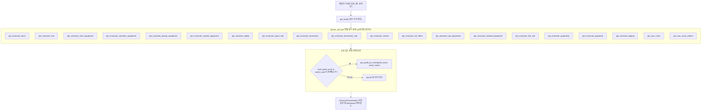

# 올인원 캐릭터 종합 스펙 대시보드 가이드 (CharacterDashboard)

## 1. 메이플 정보/스펙 분석 서비스 벤치마킹 설계

대표적인 메이플스토리 정보/스펙 분석 사이트(메이플스카우터, 츄츄지지, 메애기, 메이플로드, 메짱 등)를 분석하면, 사용자가 캐릭터 닉네임을 검색했을 때 첫 화면에 노출하는 공통 핵심 지표들이 있습니다:

1. **핵심 스펙**: 전투력, 스타포스 총합, 아케인포스, 어센틱포스, 무릉도장 최고 층수
2. **소속 길드**: 길드명, 길드 레벨, 길드 마스터, **노블레스 길드 스킬 포인트 총합** (크게 한방, 길드의 이름으로 등)
3. **유니온 & 아티팩트**: 유니온 레벨/등급, 배치된 공격대원 스탯, 아티팩트 레벨 및 활성 크리스탈 효과
4. **6차 헥사 매트릭스**: 활성화된 헥사 코어 목록, 헥사 스탯 레벨 (크뎀/주스탯/공마 등)
5. **어빌리티**: 등급(레전드리/유니크) 및 3줄 옵션
6. **코디 및 외형**: 현재 인게임 룩, 헤어/성형 믹스염색 비율, 겉에 보이는 최종 장비 목록 및 모루/프리즘 여부

기존 방식대로라면 개발자가 15~20개의 서로 다른 OpenAPI 엔드포인트를 순차 또는 수동으로 비동기 호출하여 병합해야 했습니다.
`maplestory-openapi`는 이를 **단 1번의 닉네임 호출로 해결하는 올인원 대시보드 (`CharacterDashboard`)**를 제공합니다.

---

## 2. 병렬 취합 및 탄력적 폴백 구조

`client.get_character_dashboard_by_name("온앤온")` 호출 시 내부 동작 과정:



### 탄력적 폴백 (Resilience)
- 6차 전직을 하지 않은 260레벨 미만 캐릭터의 경우 `hexamatrix` 엔드포인트가 에러를 반환할 수 있습니다.
- 길드가 없는 무길드 캐릭터의 경우 길드 엔드포인트를 호출하지 않아야 합니다.
- `CharacterDashboard`는 필수 기본 정보(`basic`, `stat`, `equip`, `cash`, `beauty`) 외의 부가 정보들은 모두 `Result.ok() -> Option<T>`로 안전하게 폴백하여, 일부 엔드포인트가 실패하더라도 전체 조회가 중단되지 않습니다.

---

## 3. 주요 도메인 접근자 (Domain Accessors)

`CharacterDashboard`는 원본 JSON 트리 구조를 일일이 탐색하지 않고도, 상용 서비스 화면에 곧바로 바인딩할 수 있는 편리한 접근자를 제공합니다:

```rust
let dash = client.get_character_dashboard_by_name("온앤온").await?;

// 1. 전투력 (String -> u64 파싱 완료)
println!("전투력: {}", dash.combat_power()); // 441,857,861

// 2. 스타포스 및 심볼 포스 합계
println!("스타포스: {}성", dash.total_starforce()); // 393성
println!("아케인포스: {}", dash.arcane_force());   // 1320
println!("어센틱포스: {}", dash.authentic_force()); // 680

// 3. 유니온 및 아티팩트
println!("유니온: Lv.{}", dash.union_level().unwrap_or(0));
println!("유니온 등급: {:?}", dash.union_grade());
println!("아티팩트: Lv.{}", dash.union_artifact_level().unwrap_or(0));

// 4. 길드 및 노블레스 스킬
println!("길드: {:?}", dash.guild_name());
println!("노블레스 스킬 총합: {} 포인트", dash.noblesse_skill_points());

// 5. 어빌리티 등급 및 무릉도장
println!("어빌리티: {:?}", dash.ability_grade());
println!("무릉도장 최고 층수: {}층", dash.dojang_best_floor());
```
