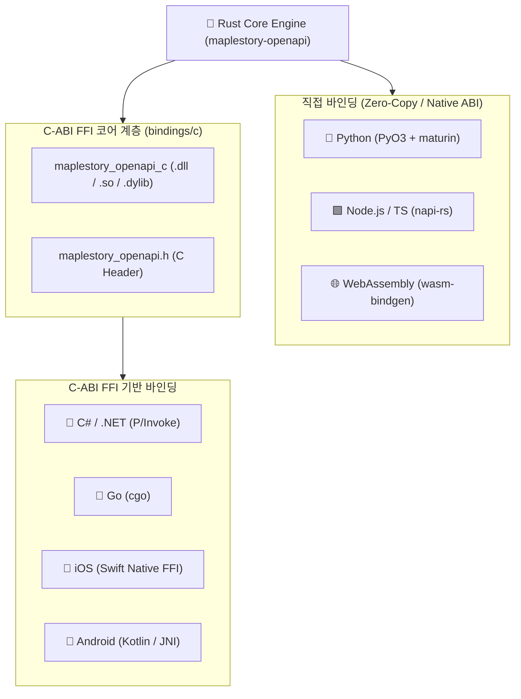

# Rust 기반 다국어 네이티브 바인딩 아키텍처 (Multi-Language Bindings)

이 문서는 Rust로 작성된 `maplestory-openapi` 코어 엔진을 기반으로 **Python, Node.js/TypeScript, WebAssembly, C# .NET, Go, 모바일(iOS Swift / Android Kotlin)** 공식 네이티브 바인딩을 구축한 아키텍처 원리와 사용 방법을 설명합니다.

---

## 1. 다국어 바인딩 원리 및 아키텍처

Rust는 가비지 컬렉터(GC)가 없고 런타임 오버헤드가 없으며, 표준 C-ABI(Application Binary Interface) 규격을 완벽하게 지원합니다.  
따라서 코어 로직(네트워크 통신, 병렬 취합, JSON 역직렬화, 코디 합성, GIF 인코딩)을 단 한 번 Rust로 견고하게 작성하면, 모든 프로그래밍 언어에서 제로-오버헤드로 임베딩하여 실행할 수 있습니다.



---

## 2. 지원 언어별 구현 내역 및 빠른 시작

### 🐍 1. Python (`bindings/python`)
- **기술 스택**: `PyO3 0.22`, `maturin`, `pyo3-async-runtimes`, `pythonize`
- **특징**: Rust 모델을 파이썬 네이티브 `dict`로 직렬화하여 반환. 캐릭터 대시보드/프로필/코디, 길드(`get_guild_basic`, `get_guild_profile`), 유니온(`get_user_union`, `get_user_union_artifact`, `get_user_union_raider`), 랭킹(`get_overall_ranking`, `get_union_ranking`, `get_guild_ranking`, `get_dojang_ranking`), 확률/강화 이력(`get_starforce_history`, `get_potential_history`, `get_cube_history`, `get_soul_potential_history`), 공지/이벤트(`get_notice_list`, `get_event_notice_list` 등), 계정 요약(`get_account_summary`), 스케줄러(`get_scheduler_character_state`) 완벽 지원.
- **빌드 및 로컬 설치**:
  ```bash
  cd bindings/python
  maturin develop --release
  ```
- **사용 예시**:
  ```python
  import asyncio
  from maplestory_openapi import MapleStoryClient

  async def main():
      client = MapleStoryClient.from_env()
      dash = await client.get_character_dashboard("온앤온")
      print(f"{dash['basic']['character_name']} 레벨: Lv.{dash['basic']['character_level']}")

      # 길드 종합 프로필 및 유니온 조회
      guild = await client.get_guild_profile("리더", "스카니아")
      union_info = await client.get_user_union("온앤온")

      # 걷기 애니메이션 GIF 바이트 생성
      gif_bytes = await client.render_character_gif("온앤온", "walk", 128, 128)
      with open("walk.gif", "wb") as f:
          f.write(gif_bytes)

  asyncio.run(main())
  ```

---

### 🟩 2. Node.js / TypeScript (`bindings/nodejs`)
- **기술 스택**: `napi-rs 2.16`
- **특징**: 컴파일 시 `index.d.ts` 타입 정의 자동 생성. 캐릭터/길드/유니온/랭킹/확률 이력/공지/계정 요약/스케줄러 전체 엔드포인트 및 Node `Buffer` 기반 GIF 렌더링 지원.
- **빌드 및 로컬 테스트**:
  ```bash
  cd bindings/nodejs
  npm install
  npm run build
  node --test test_smoke.mjs
  ```
- **사용 예시**:
  ```typescript
  import { MapleStoryClient } from 'maplestory-openapi';
  import * as fs from 'fs';

  const client = MapleStoryClient.fromEnv();
  const dash = await client.getCharacterDashboard("온앤온");
  console.log(`${dash.basic.character_name} Lv.${dash.basic.character_level}`);

  const guild = await client.getGuildProfile("리더", "스카니아");
  const notices = await client.getNoticeList();

  const gifBuffer = await client.renderCharacterGif("온앤온", "walk", 128, 128);
  fs.writeFileSync("walk.gif", gifBuffer);
  ```

---

### 🌐 3. WebAssembly / 브라우저 (`bindings/wasm`)
- **기술 스택**: `wasm-bindgen`, `serde-wasm-bindgen`
- **특징**: 서버를 거치지 않고 웹 브라우저/클라이언트에서 1024자리 Base16 아바타 코드를 디코딩하고, 실시간 포즈 URL 및 프레임 시퀀스를 0ms로 계산.
- **빌드**:
  ```bash
  cd bindings/wasm
  wasm-pack build --target web
  ```
- **브라우저 사용 예시**:
  ```javascript
  import init, { decodeAvatarLook, buildAvatarUrl } from './pkg/maplestory_openapi_wasm.js';

  await init();
  const parsed = decodeAvatarLook(avatarUrl);
  // 점프+웃는 표정 실시간 변환 URL 획득
  const jumpUrl = buildAvatarUrl(parsed.code, "jump", 1, "smile", 1, "default");
  ```

---

### 🔷 4. C / C++ & C# / .NET (`bindings/c`, `bindings/dotnet`)
- **기술 스택**: C-ABI (`maplestory_openapi.h`) + C# P/Invoke (.NET 8.0, .NET 9.0, .NET Standard 2.0 멀티 타겟)
- **특징**:
  - 스레드 로컬 에러 진단 메시지(`maplestory_last_error_message()`)를 통해 FFI 경계 너머로 상세한 Rust 에러 원인을 전달합니다.
  - `GetCharacterDashboardAsync`, `GetGuildProfileAsync`, `GetUserUnionAsync`, `GetOverallRankingAsync`, `GetNoticeListAsync`, `GetAccountSummaryAsync`, `RenderCharacterGifAsync` 지원.
- **사용 예시 (C#)**:
  ```csharp
  using MapleStory.OpenApi;

  using var client = MapleStoryClient.FromEnv();
  string dashJson = await client.GetCharacterDashboardAsync("온앤온");
  string guildJson = await client.GetGuildProfileAsync("리더", "스카니아");
  string noticeJson = await client.GetNoticeListAsync();

  byte[] gif = await client.RenderCharacterGifAsync("온앤온", "walk", 128, 128);
  File.WriteAllBytes("walk.gif", gif);
  ```

---

### 🐹 5. Go (`bindings/go`)
- **기술 스택**: `cgo` 기반 패키지 (`go 1.20+`)
- **특징**: `GetCharacterDashboard`, `GetGuildProfile`, `GetUserUnion`, `GetOverallRanking`, `GetNoticeList`, `GetAccountSummary`, `RenderCharacterGif` 지원 및 `maplestory_last_error_message` 기반 상세 에러 반환.
- **사용 예시**:
  ```go
  package main

  import (
      "fmt"
      "os"
      "maplestory-openapi/bindings/go"
  )

  func main() {
      client, _ := maplestory.FromEnv()
      defer client.Close()

      dashJson, _ := client.GetCharacterDashboard("온앤온")
      guildJson, _ := client.GetGuildProfile("리더", "스카니아", "")
      fmt.Println(dashJson, guildJson)

      gif, _ := client.RenderCharacterGif("온앤온", "walk", 128, 128)
      os.WriteFile("walk.gif", gif, 0644)
  }
  ```

---

### 📱 6. 모바일 (iOS Swift & Android Kotlin) (`bindings/mobile`)
- **iOS Swift**: C-ABI Native FFI를 활용한 Swift 클라이언트 (`bindings/mobile/swift/MapleStoryClient.swift`). `async/await`, `Foundation.Data`, `MapleStoryError.apiError(code, message)`를 지원하여 SwiftUI에서 바로 사용 가능.
- **Android Kotlin**: JNI/C-FFI 네이티브 브릿지 클라이언트 (`bindings/mobile/kotlin/MapleStoryClient.kt`). Kotlin Coroutines `suspend fun` 및 `ByteArray`를 지원하여 Jetpack Compose에서 즉시 사용 가능.

---

## 3. 워크스페이스 통합 빌드 및 검증

모든 네이티브 FFI 크레이트는 루트 `Cargo.toml` 워크스페이스에 통합 관리되므로, 다음 커맨드로 전체 크레이트와 바인딩을 검증할 수 있습니다:

```bash
cargo check --all
cargo test --all
```

